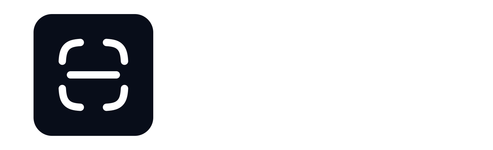

<p align="center">
  
</p>

AntiSlop is a detector for common AI slop in websites.

Inspired by the [Impeccable](https://impeccable.style/slop/) skill.

## Run

Requires Node.js 22.12 or newer. Run directly from GitHub without installing:

```sh
npx --yes --package=github:wavedevgit/antislop antislop --find-browser
```

## Usage

> [!WARNING]
> Browser scans with Puppeteer are recommended. File scans cannot reliably resolve computed styles or rendered layout and may be less accurate.

```sh
# Find Chromium-compatible browser executables
npx --yes --package=github:wavedevgit/antislop antislop --find-browser

# Scan HTML, CSS, and supported Tailwind utilities
npx --yes --package=github:wavedevgit/antislop antislop --folder ./path/to/site

# Scan computed styles in Chromium
npx --yes --package=github:wavedevgit/antislop antislop --browser /usr/bin/chromium --url https://example.com

# Open the page and highlight findings; close the tab when finished
npx --yes --package=github:wavedevgit/antislop antislop --browser /usr/bin/chromium --url https://example.com --visual

# Save a full-page PNG with highlighted findings
npx --yes --package=github:wavedevgit/antislop antislop --browser /usr/bin/chromium --url https://example.com --screenshot result.png

# Save a clean PNG report with explanations and screenshots of affected elements
npx --yes --package=github:wavedevgit/antislop antislop --browser /usr/bin/chromium --url https://example.com --screenshot-problems problems.png

# Disable rules by ID
npx --yes --package=github:wavedevgit/antislop antislop --folder ./path/to/site \
  --disable no-visible-gradients,no-neon-borders

# Check WCAG contrast without launching a browser
npx --yes --package=github:wavedevgit/antislop antislop contrast "#334155" white

# Generate text, hover, active, subtle, and border colors from one accent
npx --yes --package=github:wavedevgit/antislop antislop colors rebeccapurple
```

Browser discovery caches the selected path in `~/.cache/antislop-browser.txt`. Later runs validate the cached browser with `--version` before using it, and automatically search again if it is stale. Discovery checks environment overrides and `$PATH` first, followed by Linux Flatpak installs, macOS application bundles, standard Windows install locations, and common browser binaries or AppImages under the home directory. Home searches skip `.cache`.

Unknown rule IDs fail instead of being ignored.

See the [CLI reference](docs/cli.md) for every option, default, and exit status, or the [JavaScript API](docs/api.md) for custom integrations.

## Rules

- **Copy:** `no-unicode-bullets`, `no-text-arrows`, `no-buzzwords`, `limit-em-dashes`, `limit-emojis`
- **Typography:** `no-eyebrows-over-all-titles`, `no-decorative-monospace`, `no-overused-fonts`, `no-mostly-italic-titles`, `no-excessive-letter-spacing`, `no-oversized-cta-headings`, `limit-hero-heading-lines`
- **Visual:** `no-visible-gradients`, `no-aurora-backgrounds`, `no-patterned-backgrounds`, `no-ai-color-palette`, `no-accent-stripe-cards`, `no-nested-cards`, `no-fake-logo-cards`, `no-glassmorphism-everywhere`, `no-ghost-cards`, `no-neon-borders`, `no-thick-colored-card-borders`, `no-hover-card-borders`, `no-soft-corners-everywhere`, `no-extreme-card-radius`, `no-pill-buttons`, `no-inconsistent-button-radius`, `no-inconsistent-button-heights`, `no-slop-icons`, `no-decorative-live-status`
- **Layout:** `no-headline-badges`, `no-line-before-label`, `no-cramped-header-spacing`, `no-divided-list-rows`, `no-oversized-navbar`, `no-excessive-padding`, `no-alignment-problems`, `no-navbar-theme-toggle`
- **Structure:** `no-monolithic-html`, `require-meta-tags`, `no-unstyled-text-buttons`
- **Quality:** `no-low-contrast`, `no-text-overflow`

Rules live in `src/rules/` and are registered in `src/rules/index.ts`.

See the [rule documentation](docs/rules/README.md) for examples, detection details, and scan support.

## Agent skill

The repository includes an [`antislop-design`](skills/SKILL.md) skill for agents building websites. It gathers the palette, typography, and theme requirements before implementation, embeds the rule guidance, and requires a final AntiSlop scan.

Install it for any supported coding agent:

```sh
npx skills add wavedevgit/antislop --skill antislop-design
```

## Development

```sh
npm run lint
npm run typecheck
```

## License

GPL-3.0-only
