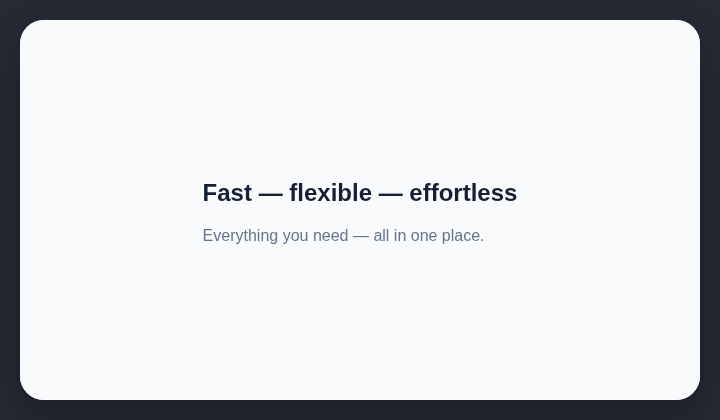

# Too many em dashes

AI-generated website copy often overuses em dashes.

## How it works

Counts em dashes in visible page copy and reports excessive use.

## How to fix

Replace decorative em dashes with periods, commas, parentheses, or shorter sentences. Keep an em dash only where the interruption changes the sentence meaning.

## Common false positives

Long-form editorial copy may intentionally use several em dashes. Review the writing style before changing quoted or authored text.

## Scan support

| File scan | Browser scan |
| --- | --- |
| Supported | Supported |
