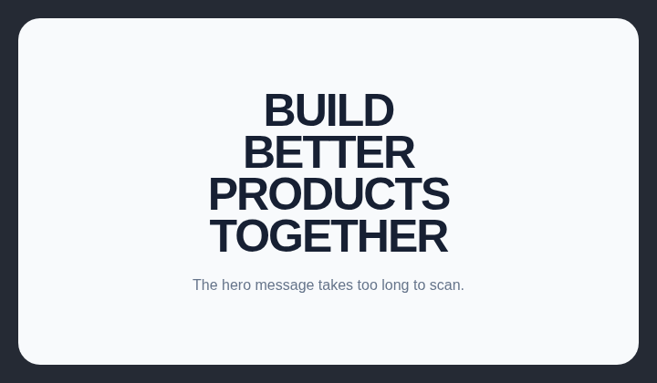

# Hero heading over three lines

Hero headings should stay within three lines so the opening message remains concise and scannable.

## How it works

Counts the rendered lines in the first visible level-one heading. File scans detect headings explicitly split across four or more lines with ` ` tags.

## Scan support

| File scan | Browser scan |
| --- | --- |
| Supported | Supported |
