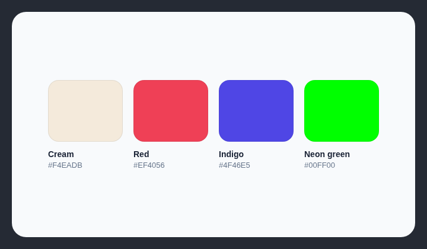

# AI color palette

Avoid color palettes that have become recognizable defaults in AI-generated interfaces. The current list contains cream colors, `#EF4056` red, `#4F46E5` indigo, and `#00FF00` neon green.

## How it works

Checks background colors against the known AI palette list in the rule. Cream is matched by hue, saturation, lightness, CSS names, and Tailwind utilities; `#EF4056`, `#4F46E5`, and `#00FF00` are matched exactly. CSS `lime` is also recognized.

## Scan support

| File scan | Browser scan |
| --- | --- |
| ✅ Supported | ✅ Supported |
