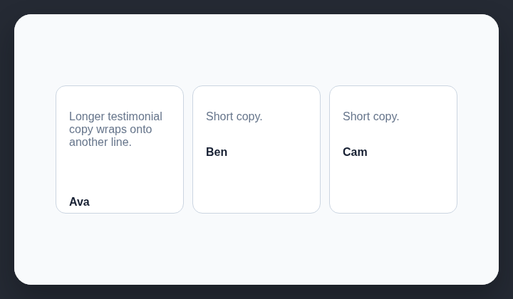

# Alignment problems

Equivalent content in a repeated row of cards should align consistently.

## How it works

Compares corresponding child positions across three or more similarly sized cards in the same rendered row.

## Scan support

| File scan | Browser scan |
| --- | --- |
| ❌ Not supported | ✅ Supported |
