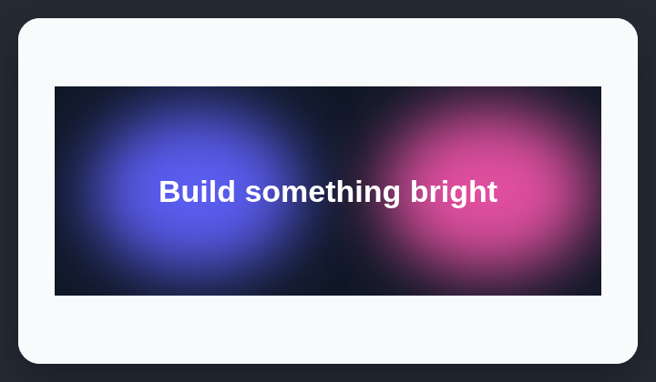

# Aurora glow background

AI-generated hero sections often use oversized blurred color blobs or layered radial gradients as atmospheric decoration.

## How it works

Looks for oversized blurred color blobs and layered radial gradients used as atmospheric backgrounds.

## Scan support

| File scan | Browser scan |
| --- | --- |
| ✅ Supported | ✅ Supported |
