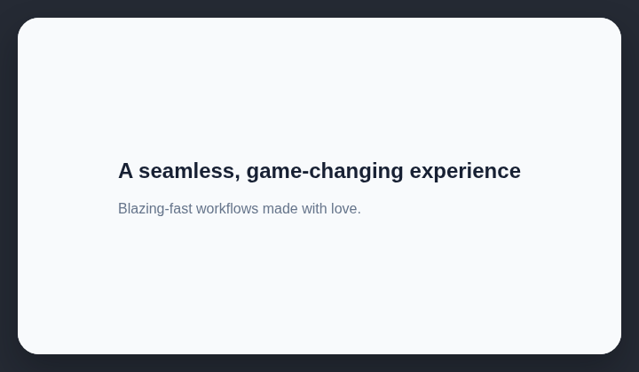

# Buzzwords

Avoid clichéd marketing copy such as “made with love,” “seamless,” “blazing,” “next-generation,” and “game-changing.”

## How it works

Searches visible copy for configured clichéd marketing phrases.

## How to fix

Replace the flagged phrase with a concrete claim that names the capability, audience, or measurable benefit.

## Common false positives

Quotes, customer language, product names, and domain terms may contain a flagged phrase legitimately.

## Scan support

| File scan | Browser scan |
| --- | --- |
| Supported | Supported |
