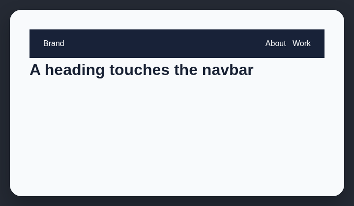

# Cramped header spacing

Navigation bars need 24px and text headings need 4px of visible separation from following content.

## How it works

Measures spacing after navigation bars and headings against minimum visible gaps.

## How to fix

Add visible separation below navigation and between headings and following content. Prefer layout `gap` or margins owned by the parent stack.

## Common false positives

Overlapping hero treatments and tightly set editorial headings may be intentional if readability remains clear.

## Scan support

| File scan | Browser scan |
| --- | --- |
| Supported | Supported |
