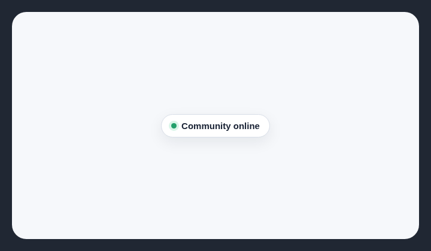

# Decorative live status

AI-generated landing pages often add live or online signals and green status dots that do not report real system state.

## How it works

Finds short live-status phrases and small circular green indicators, including pseudo-elements, inline styles, CSS rules, and common Tailwind utilities. Status, health, uptime, and incident pages are allowed, as are semantic `role="status"` and `aria-live` regions.

## How to fix

Remove the signal when it is decorative. Keep it only when it reflects current state, and expose changing status through `role="status"` or an appropriate `aria-live` region.

## Common false positives

Operational dashboards and application presence indicators may need live status outside a dedicated status page. Confirm that the value comes from real state rather than static copy.

## Scan support

| File scan | Browser scan |
| --- | --- |
| Supported | Supported |
