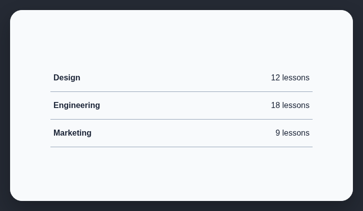

# Divided list rows

AI-generated sites often present ordinary content as repeated multi-column rows separated by horizontal rules.

## How it works

Finds repeated multi-column content rows separated by horizontal rules.

## Scan support

| File scan | Browser scan |
| --- | --- |
| Supported | Supported |
