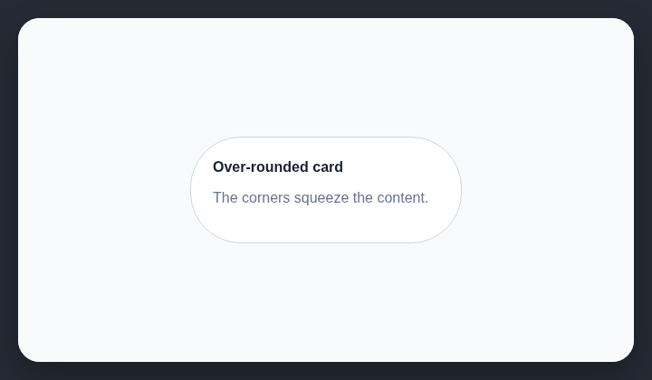

# Extreme border-radius on cards

Large corner radii can squeeze card content and make every card look alike.

## How it works

Finds card-like containers with corner radii that are unusually large for their size.

## Scan support

| File scan | Browser scan |
| --- | --- |
| ✅ Supported | ✅ Supported |
