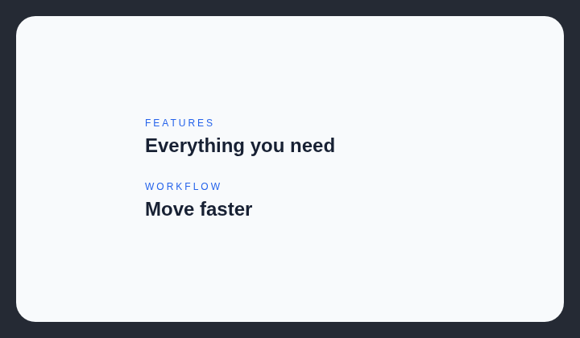

# Eyebrows over every title

AI-generated websites often place smaller, differently colored text above every large bold heading.

## How it works

Counts small accent labels immediately above headings and reports repeated use across most sections.

## Scan support

| File scan | Browser scan |
| --- | --- |
| Supported | Supported |
