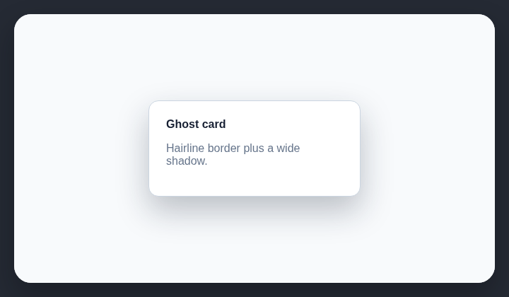

# Ghost cards

A hairline border paired with a wide soft shadow makes both effects compete to define the same card.

## How it works

Finds rounded cards that combine a hairline border with a wide soft shadow.

## Scan support

| File scan | Browser scan |
| --- | --- |
| ✅ Supported | ✅ Supported |
