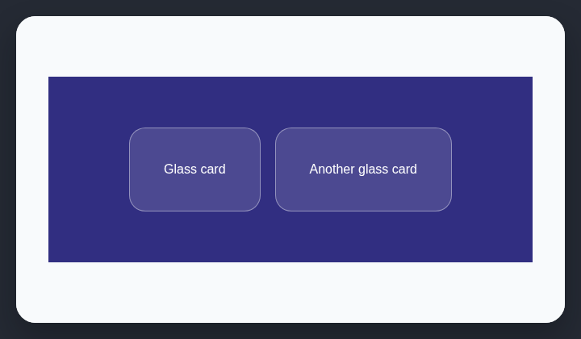

# Glassmorphism everywhere

Blur effects, glass cards, and glow borders are often used as decoration rather than to solve a real layering problem.

## How it works

Counts translucent blurred surfaces and reports repeated decorative glass effects.

## Scan support

| File scan | Browser scan |
| --- | --- |
| ✅ Supported | ✅ Supported |
