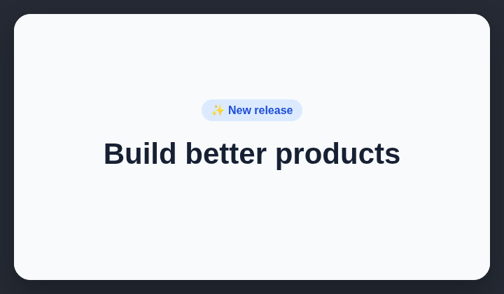

# Headline badge

AI-generated landing pages often place a decorative pill badge directly above the main headline.

## How it works

Detects a pill-shaped badge placed directly above the main page heading.

## Scan support

| File scan | Browser scan |
| --- | --- |
| Supported | Supported |
