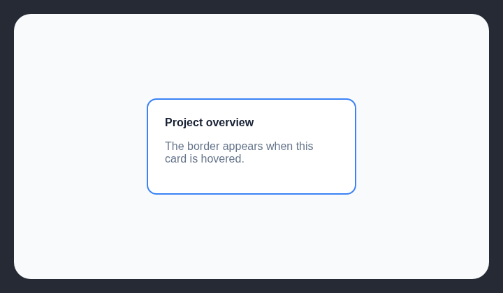

# Card border on hover

Adding a border only on hover makes cards shift or flash an unnecessary outline.

## How it works

Finds rounded, filled cards targeted by hover styles that add a visible border.

## Scan support

| File scan | Browser scan |
| --- | --- |
| Supported | Supported |
