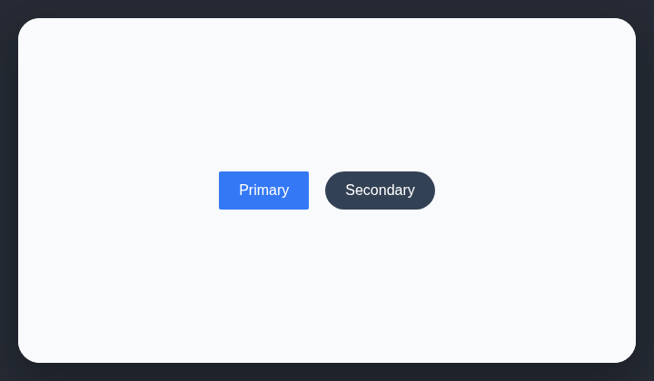

# Inconsistent button radius

Buttons in the same interface should not switch arbitrarily between square and rounded corners.

## How it works

Collects button corner radii and reports interfaces that mix conflicting radius values.

## Scan support

| File scan | Browser scan |
| --- | --- |
| Supported | Supported |
