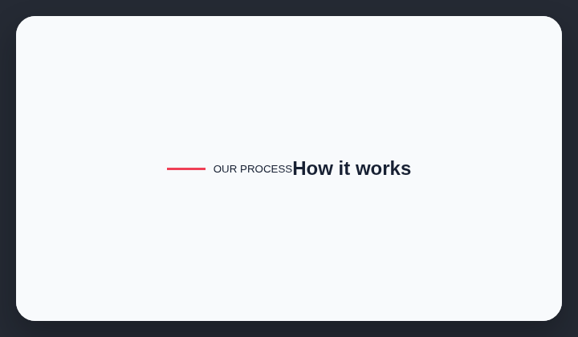

# Line before label

AI-generated sites often place a short decorative horizontal line immediately before a small label.

## How it works

Finds short decorative horizontal lines immediately before small text labels.

## Scan support

| File scan | Browser scan |
| --- | --- |
| Supported | Supported |
