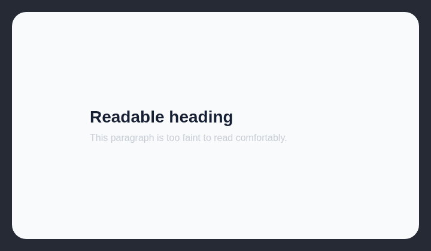

# Low contrast text

Text should meet WCAG AA contrast against the surface behind it.

## How it works

Computes rendered text contrast using WCAG thresholds: 4.5:1 for body text and 3:1 for large text.

## Scan support

| File scan | Browser scan |
| --- | --- |
| ❌ Not supported | ✅ Supported |
