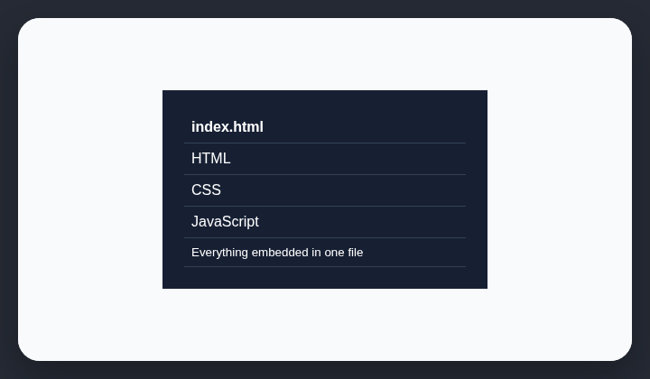

# Everything in one HTML file

AI-generated websites are often shipped as one HTML document with all code embedded inline.

## How it works

Checks whether the project is shipped as one HTML file with embedded CSS and JavaScript.

## How to fix

Move reusable CSS and JavaScript into separate source modules and let the project build process produce deployable assets.

## Common false positives

Small demos, email templates, saved reports, and intentionally portable single-file tools may be self-contained by design.

## Scan support

| File scan | Browser scan |
| --- | --- |
| Supported | Not supported |
