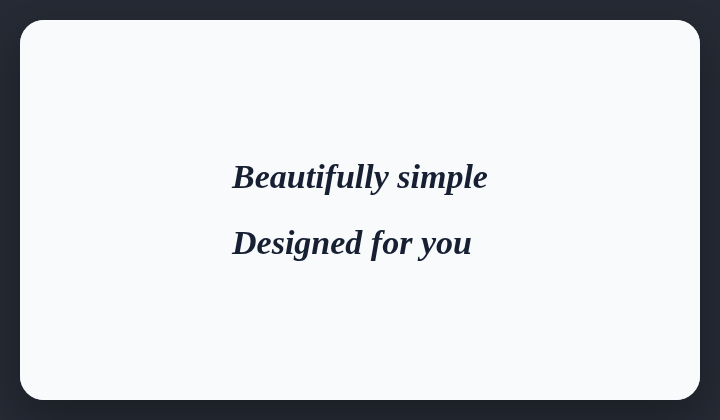

# Most titles are italic

AI-generated websites often italicize most titles instead of building a clear typographic hierarchy.

## How it works

Compares italic headings with all headings and reports when italics dominate.

## Scan support

| File scan | Browser scan |
| --- | --- |
| Supported | Supported |
