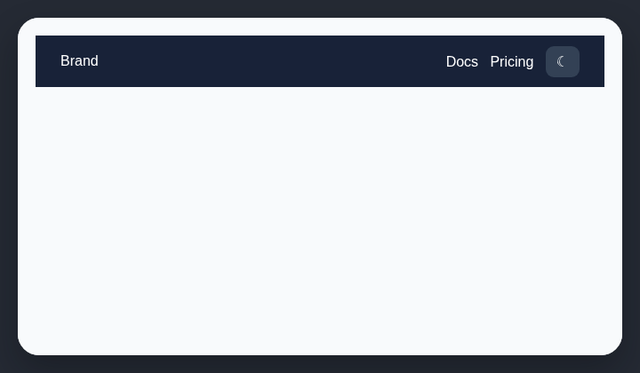

# Navbar theme switcher

Navbar theme toggles are an AI-generated website trope that people rarely use.

## How it works

Finds visible theme, dark-mode, or light-mode controls inside navbars and headers.

## Scan support

| File scan | Browser scan |
| --- | --- |
| ✅ Supported | ✅ Supported |
