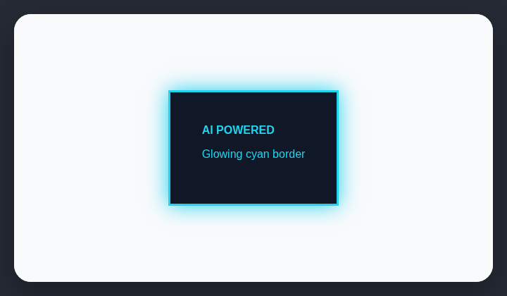

# Neon borders

AI-generated websites often pair saturated borders with matching colored glows.

## How it works

Finds saturated borders paired with a matching colored glow.

## How to fix

Remove the matching glow or reduce the border saturation. Use contrast, spacing, and restrained depth instead.

## Common false positives

Games, music tools, and intentionally neon brand systems may use luminous borders as part of their visual language.

## Scan support

| File scan | Browser scan |
| --- | --- |
| Supported | Supported |
