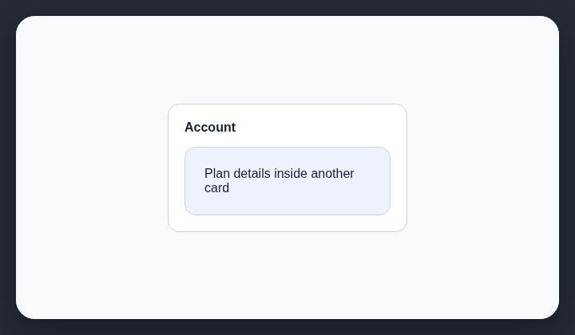

# Cards inside cards

AI-generated websites often nest rounded, filled containers inside each other, creating unnecessary visual layers.

## How it works

Detects rounded, filled card containers nested inside other card containers.

## How to fix

Flatten the hierarchy. Use spacing, dividers, headings, or one parent surface instead of another rounded filled container.

## Common false positives

Embedded widgets and independently actionable modules may need their own surface inside a larger region.

## Scan support

| File scan | Browser scan |
| --- | --- |
| Supported | Supported |
