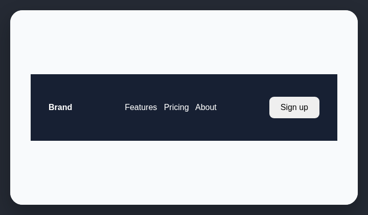

# Oversized navbar

AI-generated websites often use desktop navigation bars taller than the content requires.

## How it works

Measures desktop navigation height and reports bars taller than 64px.

## Scan support

| File scan | Browser scan |
| --- | --- |
| ✅ Supported | ✅ Supported |
