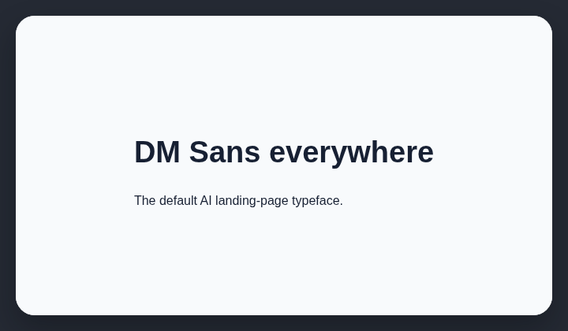

# Overused fonts

Don't use Playfair Display, Instrument Serif, Archivo, Space Grotesk, DM Sans. AI-generated websites overuse them.

## How it works

Checks font declarations and computed fonts against the configured overused-font list.

## How to fix

Choose a typeface that fits the product voice and content. Use a dependable system stack when a custom face adds no value.

## Common false positives

An established brand may already use a flagged font; consistency with that identity is more important than this heuristic.

## Scan support

| File scan | Browser scan |
| --- | --- |
| Supported | Supported |
