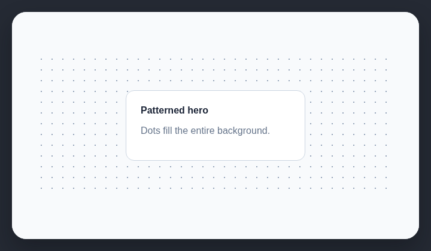

# Dotted or grid backgrounds

AI-generated websites often place repeating dot or grid patterns behind page content.

## How it works

Detects repeating CSS dot and grid background patterns.

## Scan support

| File scan | Browser scan |
| --- | --- |
| Supported | Supported |
