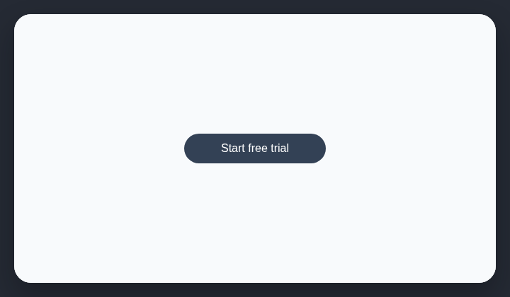

# Pill-shaped buttons

Buttons should use modest corner radii unless the control is genuinely circular.

## How it works

Finds button controls whose radius makes them fully pill-shaped.

## Scan support

| File scan | Browser scan |
| --- | --- |
| Supported | Supported |
