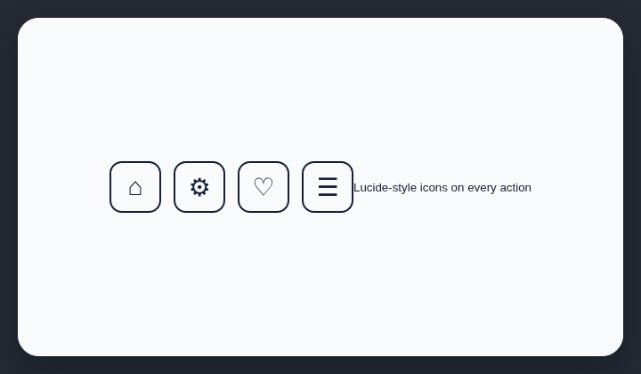

# Slop icons

Lucide icons are a common vibe-coding default that makes interfaces look AI-generated.

## How it works

Detects Lucide package imports and rendered Lucide class or data attributes.

## Scan support

| File scan | Browser scan |
| --- | --- |
| ✅ Supported | ✅ Supported |
