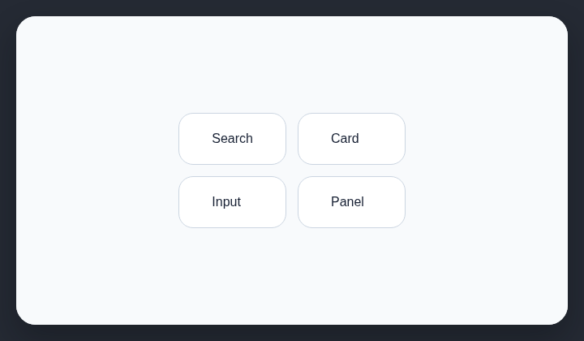

# Soft corners everywhere

AI-generated websites often apply the same soft corner radius to nearly every interface surface.

## How it works

Counts repeated moderate corner radii across many interface surfaces.

## Scan support

| File scan | Browser scan |
| --- | --- |
| ✅ Supported | ✅ Supported |
