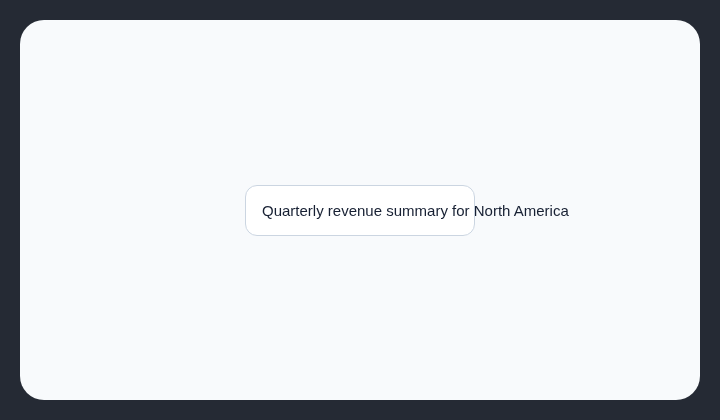

# Text overflow

Text should fit inside its container instead of spilling past the edge.

## How it works

Finds visible text that extends at least 16px beyond its container, while ignoring scrollable and intentionally truncated text.

## Scan support

| File scan | Browser scan |
| --- | --- |
| Not supported | Supported |
