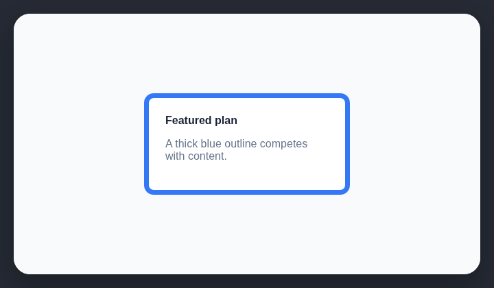

# Thick colored card borders

A thick colored border makes a rounded card's outline compete with its content.

## How it works

Finds card containers with thick, colored outlines.

## How to fix

Use a neutral hairline, a surface change, or spacing instead of a thick colored outline.

## Common false positives

Selection, validation, focus, and status states may require a prominent colored boundary.

## Scan support

| File scan | Browser scan |
| --- | --- |
| Supported | Supported |
