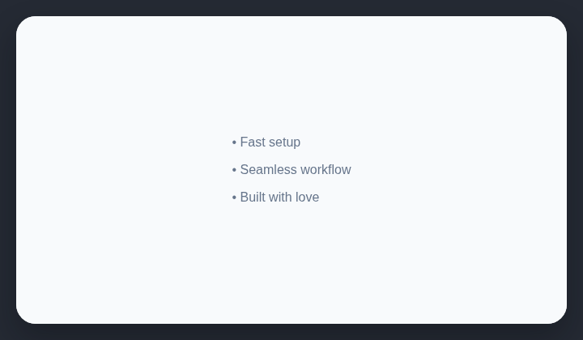

# Unicode bullets

AI-generated website copy often uses the Unicode bullet character as decoration.

## How it works

Counts literal Unicode bullet characters used in page copy.

## Scan support

| File scan | Browser scan |
| --- | --- |
| Supported | Supported |
