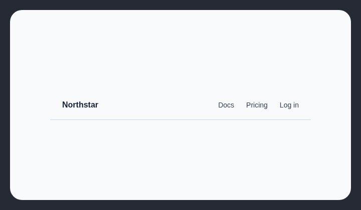

# Unstyled text button

Text-like navigation actions should use links unless the button has a visible base or hover treatment.

## How it works

Finds text buttons without a visible background, border, radius, or hover background.

## How to fix

Use an anchor for navigation. For actions, add a visible base or hover treatment and preserve keyboard focus styling.

## Common false positives

Toolbar and disclosure controls may be visually quiet when their placement, icon, label, and states still make the action clear.

## Scan support

| File scan | Browser scan |
| --- | --- |
| Supported | Supported |
