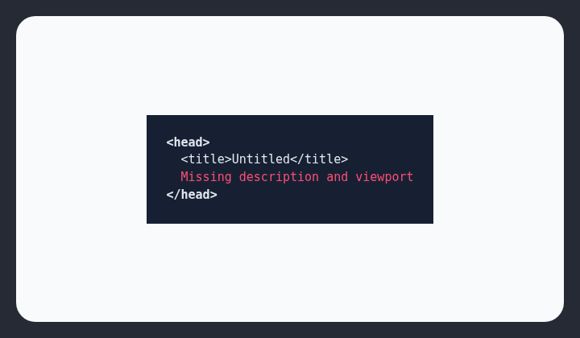

# No meta tags

Unfinished AI-generated pages often omit metadata entirely.

## How it works

Checks the document head for basic metadata such as title, description, and viewport tags.

## How to fix

Add a descriptive `<title>`, a meta description, and `<meta name="viewport" content="width=device-width, initial-scale=1">` to the document head.

## Common false positives

Embeddable fragments and HTML partials are not complete documents and may not own page metadata.

## Scan support

| File scan | Browser scan |
| --- | --- |
| Supported | Supported |
